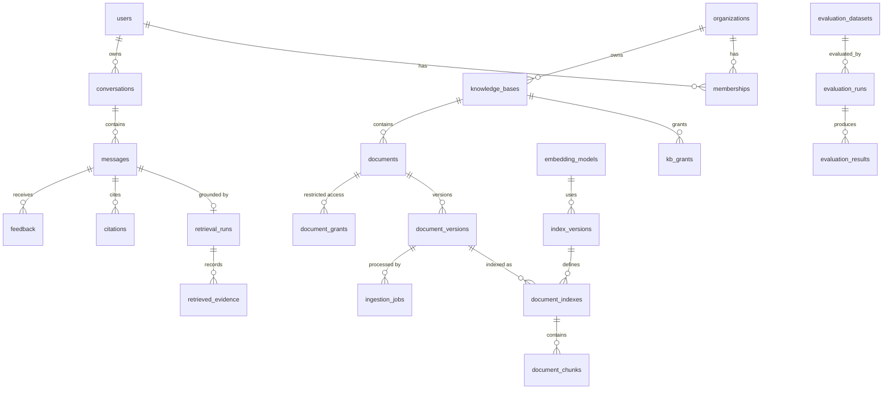

# Database Design (PostgreSQL)

Status: target design. The ingestion subset is implemented in Phase 2; see the
[persistence guide](ingestion-persistence.md) for the actual schema and operating instructions.
Identity, grants, conversations, evaluation and audit tables remain future work.
Phase 2 adds `processed` to document-version status to distinguish completed processing
from searchable `ready` versions. Jobs also record an index version and an expiring,
fenced lease (`lease_token`, `lease_expires_at`). Conventions:

* `uuid` primary keys (UUIDv7 generated in the app, so they are time-ordered and index-friendly);
  `timestamptz` everywhere, stored in UTC; `created_at`/`updated_at` on all mutable tables.
* **Tenant integrity in the schema, not only in code:** every tenant-owned table carries
  `org_id`, and child tables reference parents through **composite foreign keys**
  `(parent_id, org_id)`, so a row can never point at another tenant's parent.
* Soft delete (`deleted_at`) only where users can delete and audit/retention needs it
  (documents, knowledge bases, conversations). Partial unique indexes ignore deleted rows.
* `audit_logs` is append-only: the application role has `INSERT, SELECT` only.

## 1. Entity relationships



## 2. Tables

### Identity and access

| Table | Key columns | Constraints / indexes |
|---|---|---|
| `organizations` | `id, slug, name, llm_egress_policy, deleted_at` | `UNIQUE(slug)` |
| `users` | `id, email (citext), display_name, password_hash NULL, is_platform_admin, disabled_at` | `UNIQUE(email)` |
| `memberships` | `id, org_id, user_id, role` enum `org_admin, kb_manager, contributor, reader` | `UNIQUE(org_id, user_id)`; index `(user_id)` |
| `knowledge_bases` | `id, org_id, name, description, visibility` enum `org, restricted`, `retrieval_config_id, created_by, deleted_at` | `UNIQUE(id, org_id)` (composite-FK target); partial `UNIQUE(org_id, lower(name)) WHERE deleted_at IS NULL` |
| `kb_grants` | `kb_id, org_id, user_id, permission` enum `read, contribute, manage` | PK `(kb_id, user_id)`; FK `(kb_id, org_id)` → `knowledge_bases(id, org_id)`; FK `(org_id, user_id)` → `memberships` |
| `document_grants` | `document_id, org_id, user_id` | PK `(document_id, user_id)`; composite FK to `documents` |

**Effective permission** (computed per request, never cached across requests):
`platform_admin` gets no implicit document access (break-glass access is audited separately).
`org_admin` → manage all KBs in org. Otherwise: KB `visibility=org` → every member reads;
`restricted` → `kb_grants` only. Documents with `access_mode=restricted` additionally require
a `document_grants` row (or KB `manage`). Role is a ceiling: a `reader` with a `manage`
grant is still capped at read.

### Documents and indexing

| Table | Key columns | Constraints / indexes |
|---|---|---|
| `documents` | `id, org_id, kb_id, title, access_mode` enum `inherit, restricted`, `current_version_id NULL, tags text[], created_by, deleted_at` | `UNIQUE(id, org_id)`; FK `(kb_id, org_id)`; FK `current_version_id` → `document_versions` (`DEFERRABLE INITIALLY DEFERRED`); GIN on `tags` |
| `document_versions` | `id, org_id, document_id, version_number, status` enum `pending, processing, ready, failed, superseded`, `filename, file_type, mime_type, byte_size, raw_sha256, text_sha256, storage_key, canonical_text_key, page_count, parser_version, uploaded_by, warnings jsonb` | `UNIQUE(document_id, version_number)`; partial `UNIQUE(org_id, raw_sha256, document_id)`; index `(org_id, raw_sha256)` for duplicate detection; index `(org_id, text_sha256)` for embedding reuse |
| `embedding_models` | `id, name, revision, dimension, distance, max_seq_tokens, normalize` | `UNIQUE(name, revision)` |
| `index_versions` | `id, embedding_model_id, parser_version, chunking_config jsonb, chunking_fingerprint, fingerprint, qdrant_collection, status` enum `building, active, retired` | `UNIQUE(fingerprint)`; partial `UNIQUE(status) WHERE status='active'` (exactly one active index) |
| `document_indexes` | `id, org_id, document_version_id, index_version_id, status` enum `building, ready, failed, deleting`, `chunk_count, published_at` | `UNIQUE(document_version_id, index_version_id)`: the **publication gate** |
| `document_chunks` | `id` (= Qdrant point id), `org_id, document_index_id, document_id, document_version_id, chunk_index, text, char_start, char_end, page_start, page_end, heading_path text[], token_count, content_hash` | `UNIQUE(document_index_id, chunk_index)`; `CHECK(char_end > char_start)`; index `(content_hash)` for embedding reuse |
| `ingestion_jobs` | `id, org_id, document_version_id, kind` enum `ingest, reindex, delete`, `status` enum `queued, processing, retrying, completed, failed, cancelled`, `attempt, max_attempts, idempotency_key, stage, error_code, error_message, run_after, heartbeat_at, started_at, finished_at` | `UNIQUE(idempotency_key)`; partial index `(run_after) WHERE status IN ('queued','retrying')` for claiming |

### Conversations, retrieval traces, citations

| Table | Key columns | Notes |
|---|---|---|
| `conversations` | `id, org_id, user_id, title, kb_scope uuid[], deleted_at` | index `(org_id, user_id, updated_at DESC)` |
| `messages` | `id, conversation_id, role, content, status` enum `streaming, complete, cancelled, failed`, `model_config_id, prompt_version_id, retrieval_run_id, grounding_status, tokens_in, tokens_out, latency_ms` | |
| `retrieval_runs` | `id, org_id, user_id, query_hash, query_text NULL, normalized_query NULL, query_type, strategy, config jsonb, index_version_id, stage_timings jsonb, candidates_dropped_by_recheck` | `query_text` retained per org retention policy (redactable) |
| `retrieved_evidence` | `id, retrieval_run_id, chunk_id, document_version_id, stage` enum `dense, sparse, fused, reranked, selected`, `rank, score` | `UNIQUE(retrieval_run_id, stage, rank)`; no FK to chunk (history survives reindex) |
| `citations` | `id, message_id, label, chunk_id, document_id, document_version_id, page, char_start, char_end, validity, support` enum `supported, partial, unsupported, unchecked` | |
| `feedback` | `id, message_id, user_id, rating smallint CHECK (rating IN (-1,1)), comment` | `UNIQUE(message_id, user_id)` |

### Configuration, evaluation, audit

| Table | Key columns | Notes |
|---|---|---|
| `model_configurations` | `id, provider, model, params jsonb, fingerprint` | immutable; `UNIQUE(fingerprint)` |
| `prompt_versions` | `id, name, version, template, sha256` | immutable; `UNIQUE(name, version)` |
| `retrieval_configurations` | `id, config jsonb, fingerprint` | immutable; KBs point at one; rollback = repoint |
| `evaluation_datasets` | `id, name, version, split, content_sha256, item_count` | `UNIQUE(name, version)` |
| `evaluation_runs` | `id, dataset_id, index_version_id, retrieval_config_id, model_config_id, prompt_version_id, environment jsonb, status, metrics jsonb` | everything needed to reproduce the run |
| `evaluation_results` | `run_id, item_id, retrieved jsonb, answer, scores jsonb` | PK `(run_id, item_id)` |
| `audit_logs` | `id bigserial, org_id, actor_user_id, action, resource_type, resource_id, ip, user_agent, metadata jsonb, created_at` | append-only; index `(org_id, created_at DESC)`; partition by month when large |

## 3. Relationship to Qdrant

| Postgres | Qdrant |
|---|---|
| `index_versions.qdrant_collection` | collection name |
| `document_chunks.id` | point id (UUIDv5, deterministic) |
| `org_id, kb_id, document_id, document_version_id, document_index_id` | payload filter fields (keyword indexes) |
| `document_indexes.status = 'ready'` | payload `published = true` (set after all points are written) |
| `documents.access_mode = 'restricted'` | payload `restricted = true` |
| `document_chunks.text` | **not stored** in Qdrant |

Postgres decides; Qdrant accelerates. The re-check query after vector search:

```sql
SELECT c.id, c.text, c.document_id, c.document_version_id, c.page_start, c.page_end,
       c.char_start, c.char_end, c.heading_path
FROM document_chunks c
JOIN document_indexes di ON di.id = c.document_index_id AND di.status = 'ready'
JOIN document_versions v ON v.id = c.document_version_id
JOIN documents d ON d.id = v.document_id AND d.current_version_id = v.id AND d.deleted_at IS NULL
WHERE c.id = ANY(:candidate_ids)
  AND c.org_id = :org_id
  AND d.kb_id = ANY(:readable_kb_ids)
  AND (d.access_mode = 'inherit' OR d.id = ANY(:granted_restricted_doc_ids));
```

## 4. Partial-failure recovery

| Failure point | State left behind | Recovery |
|---|---|---|
| After object put, before DB commit | orphan object | nightly sweep deletes objects with no `document_versions.storage_key` older than 24 h |
| Worker dies mid-embedding | job `processing`, stale heartbeat | job reclaimed; idempotent rerun |
| Points upserted, DB `ready` not committed | unpublished or published points, index `building` | invisible (gate is Postgres); rerun completes or reconciler deletes after TTL |
| Delete committed, point deletion failed | stale points | invisible (re-check); reconciler deletes by `document_index_id` |
| Qdrant lost entirely | none in Postgres | rebuild collection from `document_chunks` (+ re-embed, or cached vectors) |
