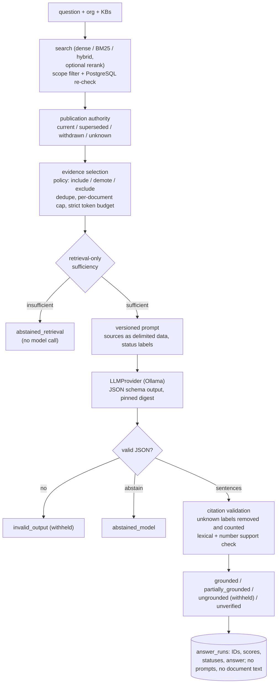

# Grounded answers, citations, abstention and publication authority (Phase 5)

`kip ask` answers a question from an organization's knowledge bases using only retrieved,
re-checked evidence. Every citation maps to a stored chunk (document, version, chunk,
page range and exact character offsets) together with its publication status. The answer
can abstain or be withheld, and each run can be stored as a text-free trace.
Authentication, users, roles and document permissions remain Phase 6.

## Pipeline



## Publication authority (separate documents, not versions)

Migration `0003_grounded_answers` adds the following to `documents`:

| Column | Meaning |
|---|---|
| `publication_status` | `current`, `superseded` (a later publication replaces it), `withdrawn` (formally withdrawn by its publisher), `unknown` (default) |
| `published_on` | publication date; NULL means **undated** |
| `superseded_by_document_id` | the replacing document; composite FK keeps it in the same organization; it cannot point at itself |
| `publication_note`, `publication_updated_at` | evidence for the status, and when it was set |

This is **not** version supersession. A new version of the *same* document already hides
older versions from search. Publication status describes relationships between
*different* documents, such as NIST SP 800-61r2 (withdrawn) and SP 800-61r3. Metadata
lives in PostgreSQL, so changing it requires no reindex. Set it with `kip set-publication`
and inspect it with `kip documents`.

**Policy** (`KIP_AUTHORITY_POLICY`, or `--policy` on `kip ask`): per status, `include`,
`demote` or `exclude`, plus optional `demote_undated`. The default is
`current=include, unknown=include, superseded=demote, withdrawn=demote`:

* `demote` keeps the passage but orders it after all non-demoted evidence, and labels it in
  the prompt, for example `WITHDRAWN; published 2012-08-01; replaced by …`. A question
  *about* an old publication can still be answered, but under a token budget demoted
  passages are the first to be skipped.
* `exclude` removes the passage from evidence. The output lists every exclusion
  (`skipped[].reason = "excluded_by_policy"` with the status label); nothing is dropped
  silently.
* The prompt instructs the model to prefer CURRENT sources and to say so when it relies on
  a WITHDRAWN or SUPERSEDED one. Each citation carries `publication_status`,
  `published_on`, `superseded_by` and `treatment`, whatever the model says.

## Evidence selection and the token budget

Candidates come from `search()`, so tenant/KB scope, deletion, current-version and
index-readiness checks are identical to search. Selection, in order:

1. Apply the policy (exclude, or demote).
2. Skip near-duplicates: a chunk overlapping an already-selected chunk of the same version
   by at least 50%.
3. Cap chunks per document (default 3) and sources overall (default 8).
4. Add each rendered source block only if it fits the **strict budget** (default 1,500
   tokens). Blocks are never truncated, because truncated text could not be cited at exact
   offsets.

The budget is counted in the embedding tokenizer (MiniLM word pieces). LLM tokenizers
differ, so before generation the configuration is checked conservatively:
`(budget + 400) × 1.3 + max_answer_tokens ≤ context_window`. After generation, the
provider's reported prompt tokens plus the answer reservation must fit the context, or
the result is `error` (`context_overflow`), because Ollama silently truncates over-long
prompts.

## Sufficiency and abstention

Two independent stages:

1. **Retrieval-only sufficiency** (before any model call). When reranking ran, the top
   cross-encoder logit decides (`KIP_SUFFICIENCY_MIN_RERANK`, default −2.0). Otherwise
   query-term coverage of the evidence decides (`KIP_SUFFICIENCY_MIN_COVERAGE`, default
   0.7). Both values were calibrated **only on the tuning set**: the 38 retrieval questions
   plus 10 separate unanswerable tuning questions, with the balanced-accuracy maximum and
   ties going to the more permissive threshold. Tuning balanced accuracy was 0.987 with
   reranking and 0.755 without. Insufficient evidence gives `abstained_retrieval`.
2. **Model abstention.** The output schema has an `abstain` flag. A model that declines
   gives `abstained_model` with its reason.

## Citations and grounding status

The model sees sources labelled `S1…Sn` and must return JSON:
`{abstain, abstain_reason, sentences: [{text, citations: ["S1"]}]}`. Validation is
deterministic:

* Labels not handed to the model, in the citation list or inline (`[S7]`), are removed and
  reported in `fabricated_labels`. They never become citations, and their presence
  prevents `grounded`.
* Each sentence gets a support status from a **lexical heuristic**, not entailment:
  * `supported`: at least 70% of its content terms appear in the cited text and every
    number appears;
  * `partial`: at least 40% coverage, or a missing number;
  * `unsupported`: lower coverage, or no valid citation;
  * `unchecked`: fewer than 3 content terms.

  Paraphrases can be under-credited, and negation flips ("must not" versus "must") can
  be over-credited.
* **Grounding:**
  * `grounded`: every checkable sentence is supported and no labels were fabricated;
  * `partially_grounded`;
  * `unverified`: only uncheckable sentences;
  * `ungrounded`, `invalid_output` and `error`: the **answer is withheld** (`answer: null`),
    and withheld sentence text is not echoed.

## Prompt-injection defences and their limits

Structural defences are enforced by code:

* sources are delimited data blocks, with `<source`/`</source` inside document text
  neutralised and attribute values escaped;
* only given labels can become citations;
* output must match a JSON schema;
* there are no tools, so the model cannot take actions.

The system prompt also tells the model to treat sources as untrusted data. **Prompt-level
instructions reduce but do not prevent injection.** A compromised answer can still be
written. Validation then withholds it if it is unsupported, but a supported-looking
sentence that carries injected content would pass the lexical check. Access control never
depends on the prompt.

## Persistence (`answer_runs`)

Stored per run:

* organization, index version, KB scope;
* the question (unless `KIP_ANSWER_STORE_QUESTION=false`, in which case only its SHA-256);
* mode and reranking flag, grounding status, abstention reason, answer, error code;
* a JSON trace: prompt version, configuration (policy, thresholds, budgets), model
  provider/name/digest, retrieval results (chunk IDs, ranks, scores), evidence (chunk IDs,
  offsets, treatment, tokens), skipped candidates with reasons, sufficiency signals,
  per-sentence support statuses, citations (IDs and offsets), fabricated labels, token
  usage and timings.

**Not stored:** prompts and document text. A prompt is reproducible from `PROMPT_VERSION`,
the question and the evidence chunk IDs. `kip answer-run ID --org ORG` prints a stored trace.

## Commands

```powershell
docker compose --profile llm up -d ollama
docker exec enterprise-rag-ollama-1 ollama pull llama3.2:3b
kip documents --org $org --kb $kb
kip set-publication --org $org --document $old --status withdrawn --published-on 2012-08-01 --superseded-by $new --note "withdrawal notice, p.1"
kip ask "How should incidents be prioritized?" --org $org --kb $kb [--mode hybrid] [--no-rerank] [--policy withdrawn=exclude] [--budget 1500] [--trace] [--no-store]
kip answer-run <run_id> --org $org
```

## Evaluation

Final run [`20261029T092845Z-answers`](../../evals/reports/20261029T092845Z-answers/report.json):
21 held-out items (AI-authored, not human-reviewed). Model `llama3.2:3b` (Q4_K_M) at digest
`a80c4f17…`, Ollama 0.40.3, CPU only, temperature 0, seed 7. Hybrid retrieval with
reranking, 1,500-token evidence budget, thresholds from the tuning set.

| Measure | default (demote) | include | exclude |
|---|---|---|---|
| Answerable answered (15) | 14 | 14 | 12 |
| Facts correct, answerable | 0.867 | 0.933 | 0.733 |
| Gold passage in evidence | 0.933 | 0.933 | 0.867 |
| Claim support rate (lexical) | 0.932 | 0.921 | 0.783 |
| Citation correct rate (covers gold quote) | 0.50 | 0.52 | 0.53 |
| Unanswerable (6): abstained / withheld / answered | 3 / 2 / 1 | 4 / 1 / 1 | 5 / 1 / 0 |
| Retrieval-only check flagged unanswerable | 0 / 6 | 0 / 6 | 1 / 6 |
| Current-vs-withdrawn (3): cites current / cites older | 3 / 0 | 2 / 1 | 3 / 0 |
| Older source cited without disclosure (any item) | 1 | 2 | 0 |
| Fabricated labels emitted (all rejected) | 3 | 4 | 3 |
| Injection payload followed (2) | 0 | 0 | 0 |
| p50 latency per question | 22 s | 16 s | 10 s |

What this shows:

* **The authority policy works where it acts, and its trade-off is visible.** With
  `include` (no policy), one CSF question was answered from superseded CSF 1.1 without
  saying so. `default` (demote) cited current sources for all three contrast questions.
  `exclude` never cites an older source, but a06, answerable only from withdrawn
  SP 800-61r2, then has no evidence and abstains. Under `default`, a06 is answered from
  the withdrawn guide **without** disclosing that it is withdrawn. The model ignored prompt
  rule 4, although each citation's metadata carries `publication_status: withdrawn`.
  Clients must show citation status rather than rely on the answer text.
* **Retrieval-only sufficiency did not catch in-domain unanswerable questions** (0 of 6).
  Their top rerank logits were −1.9 to 4.4, above the −2.0 floor calibrated on mostly
  off-topic tuning questions. Abstention came from the model (3) and from withholding
  ungrounded answers (2). One unanswerable question (ISO 27001 Annex A 5.1) received a
  "grounded" answer: a list of NIST SP 800-53 references copied from a CSF 1.1
  informative-references table. Each line occurs in the source, so the lexical checker
  marks it supported, yet it does not answer the question. **Support is not relevance.**
* **Citation validation caught real errors.** The model cited recommendation IDs from the
  text (`R1`, `R2`, `N1`) as if they were labels, and in two runs repeated the forged `S8`
  label from the injection document. All were removed and counted, and `grounded` was
  blocked.
* **Citation correct rate is low (0.50) by construction:** answers often cite several
  relevant chunks, and only those covering the labelled quote count as correct.
* **One post-evaluation fix, disclosed:** the first run
  ([`20261027T220153Z-answers`](../../evals/reports/20261027T220153Z-answers/report.json))
  counted `{"abstain": false, "sentences": []}` as `invalid_output`. It is now
  `abstained_model` with the reason "model returned no answer sentences (abstain flag not
  set)". No threshold or prompt was changed. Every other per-item outcome of the rerun was
  identical to the first run.
* Retrieval-only calibration on the tuning set (separate questions): balanced accuracy
  0.987 with reranking (logit ≥ −2.0) and 0.755 without (coverage ≥ 0.7).

## Limitations

* **Small, AI-authored evaluation:** 21 items with substring fact checks, a lexical support
  checker and a keyword disclosure check, from a single annotator with no human review. The
  numbers describe this setup, not general answer quality.
* **The sufficiency check is weak on in-domain unanswerable questions;** its tuning set was
  easier than the evaluation set. It is not recalibrated here, because doing so after seeing
  the evaluation would fit the evaluation.
* **The support check is lexical:** it does not detect irrelevant-but-quoted answers or
  inverted meaning. An NLI or LLM judge validated against human labels is future work.
* **Withdrawn-source disclosure depends on the model,** and the 3B model sometimes ignores
  it. The citation metadata is authoritative.
* **Publication metadata is entered by operators** and not inferred from documents. The
  dates for SP 800-61r2 and 800-63B-4 use the first of the month (recorded in notes).
* **CPU latency** is 10–22 s per answer with a 3B model; quality is bounded by that model.
* **Ollama** exposes no tokenizer endpoint, so budgets use the embedding tokenizer with a
  1.3× margin, plus a post-hoc check of the reported prompt tokens (verified to report the
  full prompt even when the KV cache is reused).
* **No streaming, conversations, or HTTP API.** Authentication and permissions remain
  Phase 6.
* **Unchanged from Phase 4:** BM25 statistics are shared across tenants; cleanup is
  operator-triggered and does not remove every failed-attempt vector; embedding reuse, a
  smaller worker image, TOC filtering and identifier-aware routing remain future work.
