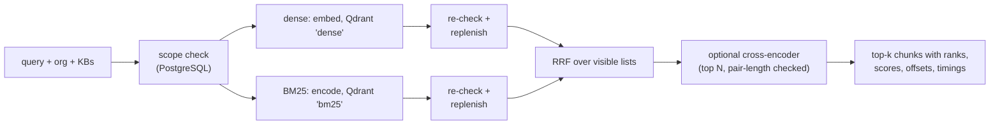

# BM25, hybrid retrieval and reranking (Phase 4)

Phase 4 adds BM25 sparse vectors inside Qdrant, three search modes (dense, BM25, hybrid)
that share one scope and one PostgreSQL re-check, Reciprocal Rank Fusion, optional
cross-encoder reranking, and the operational commands Phase 3 lacked: vector cleanup,
candidate replenishment and failed-job retry. Authentication, permissions, the HTTP API,
the dashboard and answer generation remain later phases.

## Upgrade path for existing dense collections

Qdrant cannot add a sparse vector to an existing collection. Verified on 1.18.3: the
server answers `400 Not existing vector name error: bm25`. BM25 therefore needs a **new
index version** with a new collection. Migration `0002_hybrid_retrieval` adds
`index_versions.sparse_config` (NULL = dense-only). Existing index versions keep their
fingerprints and collections unchanged, and the BM25 config enters the fingerprint only
when present.

```powershell
alembic upgrade head                                     # 0002: sparse_config, 'deleted' status
docker compose stop worker                               # stop any pre-Phase-4 worker first
$h = kip bootstrap --slug <org-slug> --kb-name <kb> --revision <model-commit> --sparse bm25 | ConvertFrom-Json
kip reindex --org <org_id> --index $h.index_version_id   # once per organization; idempotent
kip-worker --until-idle                                  # reparse, embed, BM25-encode, publish
kip activate-index $h.index_version_id                   # refused while documents are missing
```

* `kip reindex` queues the **current, published** version of every live document in the
  organization. Re-run it until it reports `{"queued": 0}`. A document version published
  after the last reindex has no job in the new index version.
* `kip activate-index` counts live documents, in every organization, whose current
  version is not `ready` in the target index version. It refuses while any are missing
  (`--force` overrides). The previous active version returns to `building` and stays
  searchable with `--index`, for comparison or rollback.
* A worker from before Phase 4 must not run during the upgrade. It would create a
  dense-only collection under the hybrid index's name, and later jobs would fail with
  `vector_collection_mismatch`.

On the development stack the upgrade reindexed 9 documents (1,307 chunks) in 58 s on CPU.
The new collection holds exactly 1,307 points.

## BM25 inside Qdrant

`rag/sparse/bm25.py` is pure Python (no numpy or qdrant imports, so the parser
subprocess stays small):

* **Tokenizer `bm25-v1`:** case-folded; identifier compounds are emitted whole **and**
  as parts (`rc.rp-01`, `rc`, `rp`, `01`; `ac-2(1)`; `800-53`; `err_conn_reset`;
  `v1.2.3`). Stop words and lone letters are dropped; there is no stemming.
* **Term index:** the first 4 bytes of BLAKE2b, stable across processes. Colliding terms
  share a slot, and their weights add.
* **Documents:** BM25 term-frequency saturation, with `k1=1.2, b=0.75` (textbook defaults)
  and `avgdl=74`. That value is the mean BM25 length of default chunks measured on this
  repository's own `docs/`, a neutral corpus, never the evaluation corpus.
* **Queries:** weight 1 per distinct term. Qdrant's `idf` modifier applies IDF at query time.
* Each point stores both vectors (`dense` and `bm25`), so one upsert, one deterministic ID
  and one payload filter serve both retrievers.

> **IDF is collection-wide.** Verified on Qdrant 1.18.3: a query filtered to one tenant
> still scores with document frequencies from *all* points in the collection, including
> other tenants and vectors of deleted documents not yet cleaned up. No text crosses
> tenants (results are filtered and re-checked), but **tenants influence each other's
> BM25 scores**. Per-tenant collections would remove this coupling; not done yet.

## Search pipeline



* **One filter builder** (`_scope`) serves dense and sparse queries: `org_id`,
  `kb_id IN (...)`, `published=true`. Both lists then pass the same PostgreSQL re-check:
  same organization, document index `ready` in this index version, current `ready`
  version, document and knowledge base not deleted, knowledge base in scope.
* **Replenishment:** each retriever starts at `wanted × SEARCH_OVERFETCH` candidates. If
  fewer than `wanted` survive the re-check, it doubles the limit and queries again, until
  enough are visible, Qdrant returns fewer than asked (`exhausted`), or
  `SEARCH_MAX_CANDIDATES` (default 200) is reached (`capped`). Diagnostics report
  `rounds`, `returned`, `visible`, `dropped`, `exhausted` and `capped` per retriever.
* **Fusion after the re-check:** ranks are recomputed over visible candidates, so stale or
  unauthorized points cannot shift the RRF rank of visible ones.
* **RRF:** `score = Σ weight / (k + rank)` with `k=60` (Cormack et al. 2009, and the
  retrieval design) and equal weights. Within one list a repeated ID keeps its best rank.
  Ties are broken by best rank, then the number of lists, then the ID, so output is fully
  deterministic. Raw cosine and BM25 scores are never compared or added.
* **Reranking:** `cross-encoder/ms-marco-MiniLM-L6-v2` at commit `233902d2…`. On load it
  verifies `max_length=512` and a single output label. It scores the top
  `RERANK_CANDIDATES` (default 30, at most 100) using the chunk's embedding text
  (heading prefix plus passage). Every pair is token-counted with the reranker's own
  tokenizer, and a pair over 512 tokens is **refused, not truncated**. Outputs are raw
  logits (identity activation): they order candidates and are not probabilities. On the
  NIST corpus the longest observed pair was 209 tokens.

## CLI

```text
kip search QUERY --org ID --kb ID [--kb ID ...] [--index ID] [--top-k N]
    [--mode auto|dense|sparse|hybrid] [--rerank] [--rerank-candidates N]
    [--candidates N] [--rrf-k K] [--explain] [--max-chars N]
```

`auto` selects hybrid when the index version has BM25 vectors and dense otherwise; the
output records the resolved mode. Sparse and hybrid modes on a dense-only index version
are refused. Each result reports `score` with its `score_kind` (`cosine`, `bm25`, `rrf`,
or `cross_encoder_logit`), `retrieval_rank` (before reranking), `dense_rank`/`dense_score`,
`sparse_rank`/`sparse_score`, `fused_score` and `rerank_score`. The response also contains
per-retriever statistics, fusion and reranker settings, and per-stage timings. `--explain`
adds the raw Qdrant lists with a `visible` flag per candidate.

Settings (prefix `KIP_`): `SEARCH_OVERFETCH`, `SEARCH_MAX_CANDIDATES`,
`HYBRID_CANDIDATES` (default 50), `RRF_K`, `RERANK_MODEL`, `RERANK_REVISION`,
`RERANK_MAX_LENGTH`, `RERANK_CANDIDATES`.

## Operations

| Command | Behaviour |
|---|---|
| `kip retry-failed --org ID [--job ID] [--error-code CODE]` | Row-locked transition `failed → queued` with a fresh attempt budget; a `failed` version becomes `pending`. Completed, running and cancelled jobs are never touched. Jobs whose document or knowledge base is deleted, or whose index version is retired, are skipped with a reason. Scoped to one organization. |
| `kip cleanup-vectors --org ID` | Two phases. (1) In one transaction, mark obsolete document indexes `deleting`: the document or KB is deleted, or the version is older than the document's current version. Indexes with a queued, running or retrying job are skipped. (2) For each `deleting` index, delete its points by filter, verify the count is zero, then mark it `deleted`. A Qdrant failure leaves it `deleting`, and the command exits non-zero; running it again retries. Chunk rows stay in PostgreSQL for history and are never visible again. |
| `kip reindex --org ID --index ID` | See the upgrade path above. |
| `kip activate-index ID [--force]` | Coverage-checked activation. |

The publication transaction requires `building` status, so an index marked `deleting`
cannot be resurrected by a racing attempt.

## Evaluation

Report [`20261027T115951Z-compare-f701a4f0`](../../evals/reports/20261027T115951Z-compare-f701a4f0/report.md):
38 questions, the same corpus, questions and labels as Phase 3, and the hybrid index
version on CPU. Brackets are 95% bootstrap intervals over questions.

| Configuration | Recall@5 | Recall@10 | MRR@10 | p50 / p95 latency |
|---|---|---|---|---|
| dense | 0.553 [0.39, 0.70] | 0.711 [0.57, 0.86] | 0.392 [0.27, 0.51] | 38 / 52 ms |
| BM25 | 0.776 [0.64, 0.89] | 0.829 [0.71, 0.93] | 0.611 [0.48, 0.73] | 15 / 50 ms |
| hybrid (RRF) | 0.789 [0.66, 0.89] | 0.868 [0.76, 0.96] | 0.554 [0.42, 0.68] | 90 / 117 ms |
| hybrid + rerank | 0.829 [0.71, 0.93] | 0.882 [0.78, 0.97] | 0.724 [0.60, 0.84] | 711 / 790 ms |

Paired per-question differences:

| Comparison | ΔRecall@5 | ΔMRR@10 | better / worse / same (R@5) |
|---|---|---|---|
| BM25 − dense | +0.22 [+0.05, +0.38] | +0.22 [+0.07, +0.38] | 11 / 2 / 25 |
| hybrid − BM25 | +0.01 [−0.11, +0.13] | −0.06 [−0.16, +0.03] | 3 / 3 / 32 |
| hybrid + rerank − hybrid | +0.04 [−0.08, +0.16] | +0.17 [+0.05, +0.29] | 4 / 2 / 32 |

What the data supports, and what it does not:

* **Dense reproduces Phase 3 exactly** on both the old and the new index version, with
  identical metrics and identical top-5 lists for all 38 questions. A repeated four-way
  run reproduced every metric, top-5 list and older-publication row.
* **BM25 beats dense on this dataset.** Hybrid is not measurably better than BM25
  alone. Reranking improves **ordering** (MRR) over hybrid, but its Recall@5 change is
  within noise.
* **Likely lexical bias in the questions.** They were written by an AI assistant reading
  the documents, so many reuse document vocabulary, which favours BM25. The *paraphrase*
  category is the control: dense and BM25 both reach 0.25 Recall@5 there (n=8), hybrid
  0.50 and hybrid+rerank 0.625. Small categories (identifier n=3, multi-document n=2,
  version-sensitive n=3) are anecdotal; hybrid's multi-document Recall@5 dropped from
  0.50 to 0.25 (one question).
* **Older publications are not handled by any mode, including reranking.** For the 11
  questions labelled only on SP 800-61r3 or CSF 2.0, the older publication (a separate
  document, per `lineage.json`) appeared in the top 5 for 5/11 (dense), 3/11 (BM25),
  4/11 (hybrid) and 2/11 (hybrid+rerank). It outranked the first relevant result in
  4/11, 2/11, 2/11 and 2/11. With reranking, q21 still ranks the withdrawn SP 800-61r2
  first and the current r3 answer second. Nothing in retrieval knows about withdrawal or
  recency. That needs metadata (status, publication date, lineage) and an explicit
  policy, not a better ranker.
* **Table-of-contents chunks** reach the top 5 for 9/38 questions with dense, 5/38 with
  BM25, 6/38 with hybrid and 5/38 with reranking (dot-leader heuristic; 7.9%, 2.6%, 4.7%
  and 2.6% of top-5 results). They are measured, not filtered.
* **Cross-tenant check:** 0 results from the second tenant's identical documents, in
  every mode.
* No parameter (k1, b, avgdl, RRF k, candidate counts, reranker depth) was tuned on these
  questions. With 38 questions and no held-out split, tuning would only fit noise.

## Limitations and remaining work

* **Withdrawn and superseded publications stored as separate documents** are ranked like
  any other document. Version supersession *within* a document is enforced (only the
  current version is visible); cross-document lineage is not.
* **Collection-wide IDF** couples tenants' BM25 statistics; deleted but not yet cleaned-up
  points also count.
* **PDF extraction splits some identifiers** (`RS.CO -02`), which weakens exact matching.
  Even BM25 does not rank the `RC.RP-01` passage first for the bare query `RC.RP-01`.
* **Cleanup is operator-driven.** No scheduler runs `cleanup-vectors`. A fenced-out
  attempt that writes points after its index was marked `deleting` can leave unpublished
  orphans that cleanup will not revisit. Unpublished points of a newer version whose job
  failed permanently are not removed unless the document is later deleted or superseded.
* **Replenishment re-queries Qdrant** with a larger limit (no pagination); work grows with
  the cap. `capped=true` signals that fewer than `top_k` visible results may exist beyond
  the cap.
* **Reranking costs about 600 ms per query on CPU** for 30 candidates.
* **Not implemented:** embedding reuse across versions (unchanged chunks are re-embedded),
  query rewriting and identifier routing, per-tenant collections, TOC filtering, and
  worker-image size reduction (about 2.1 GB, mostly CPU PyTorch). Authentication and
  permissions are Phase 6.
