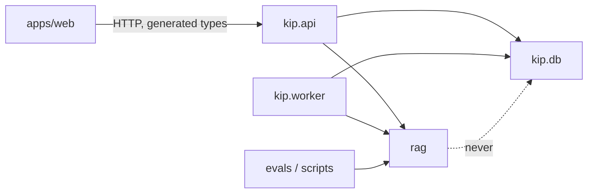

# Repository Architecture

Directories are created when they receive working code; empty placeholders are not
committed. ✅ = exists now.

```text
enterprise-rag-intelligence/
├── rag/                      ✅ framework-free domain library (no FastAPI/SQLAlchemy imports)
│   ├── config.py             ✅ versioned, fingerprinted ChunkingConfig, IngestionLimits
│   ├── errors.py             ✅ typed ingestion errors with stable codes + retryable flag
│   ├── ingestion/            ✅ validation, identity (hashes, point ids), pure pipeline
│   ├── parsing/              ✅ pdf, docx, txt/markdown parsers; normalization; canonical text
│   ├── chunking/             ✅ token counters, sentence splitter, chunking strategies
│   ├── embeddings/           ✅ Embedder protocol, pinned MiniLM loader, vector/token validation
│   ├── indexing/             ✅ Qdrant collection checks, payload indexes, upsert/publish/delete/search
│   ├── sparse/               ✅ BM25 tokenizer and term weighting (pure Python)
│   ├── reranking/            ✅ pinned cross-encoder with pair-length checks (lazy torch)
│   ├── retrieval/            ✅ dense.py, sparse.py, fusion.py (RRF)
│   ├── query/                Phase 4  normalization, identifier extraction, routing
│   ├── context/              Phase 5  evidence sufficiency, token-budgeted selection
│   ├── generation/           Phase 5  LLMProvider protocol, Ollama provider, prompt templates
│   ├── citations/            Phase 5  label mapping, validity, support checks
│   └── evaluation/           ✅ quote-span labels, retrieval metrics, bootstrap CIs; lab UI Phase 9
├── apps/
│   ├── api/                  ✅ Phase 2 infrastructure (package `kip`); HTTP/auth in Phase 6
│   │   ├── src/kip/          ✅ cli.py, ingestion.py, retrieval.py, maintenance.py, evaluation.py, vectors.py, settings.py, worker/, db/, storage/
│   │   └── migrations/       ✅ Alembic environment; 0001 ingestion, 0002 hybrid retrieval
│   └── web/                  Phase 7  Next.js + TypeScript dashboard
├── packages/contracts/       Phase 7  TS types generated from the FastAPI OpenAPI schema
├── infrastructure/docker/    ✅ worker image; monitoring/ and aws/ remain future work
├── docker-compose.yml        ✅ Postgres, Qdrant, optional migration/worker profile
├── evals/                    ✅ datasets/nist-security (manifest + questions), reports/ (corpus git-ignored)
├── scripts/                  ✅ ingest_preview.py, fetch_corpus.py (SHA-256 pinned), evaluate_retrieval.py
├── tests/                    ✅ unit/, integration/; security/, evaluation/, e2e/ as phases land
├── docs/                     ✅ architecture/, rag/
├── .github/workflows/ci.yml  ✅ lint, format, mypy --strict, pytest (3.12, 3.13)
└── pyproject.toml            ✅
```

## Decisions and deviations from the suggested layout

| Decision | Reason |
|---|---|
| `rag/` has no web, DB or queue dependencies | The retrieval/evaluation core is unit-testable in milliseconds, reusable from the API, the worker and offline evaluation scripts, and cannot accidentally depend on request state |
| API and worker are **one package (`kip`) with two entrypoints**, not `apps/api` + `workers/ingestion` | They share SQLAlchemy models, storage and auth code, and the same container image. A separate `workers/` package would either duplicate models or import the API package anyway |
| TypeScript contracts are **generated** from OpenAPI | One source of truth for request/response schemas; CI fails on drift |
| No LangChain / LlamaIndex | Each stage (fusion, reranking, context selection, citation mapping) is small, and making it explicit is the point of the project; frameworks would hide exactly the logic under evaluation |
| Job queue in Postgres (ADR-001 in system-architecture.md) | Transactional enqueue with the document row |
| Docker Compose in Phase 2 | Postgres and Qdrant development services plus an optional migration/worker profile; see the ingestion persistence guide |

## Dependency direction


