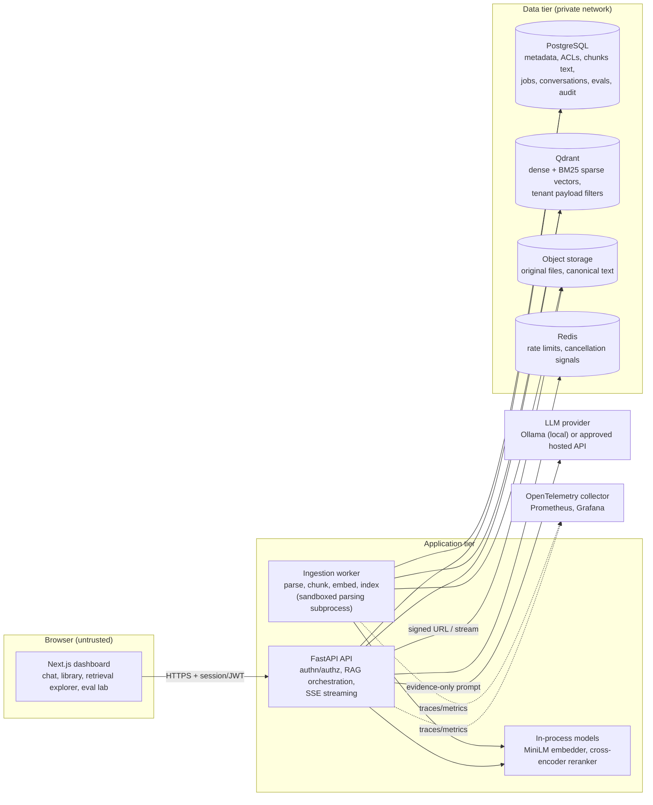
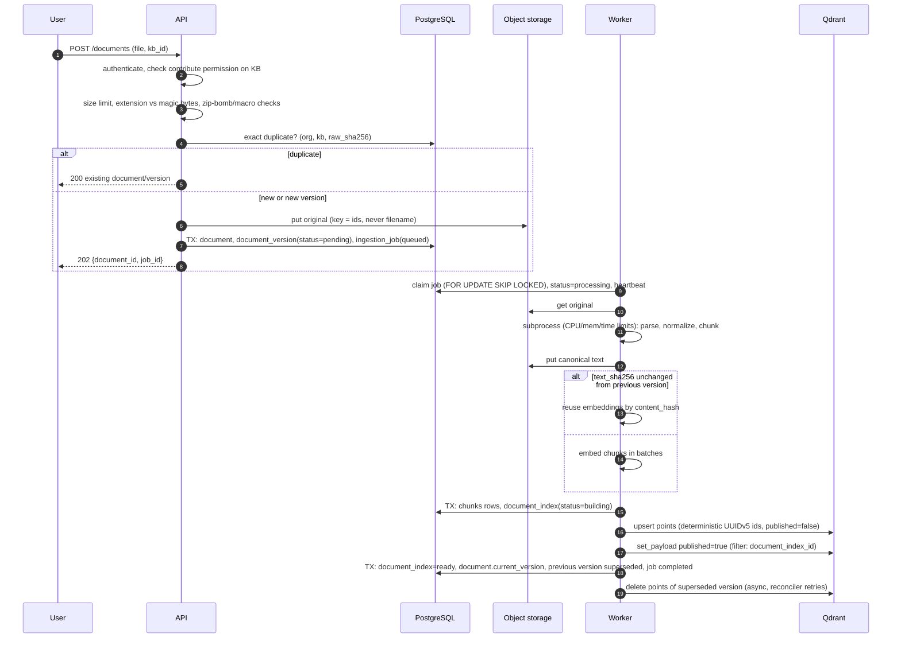
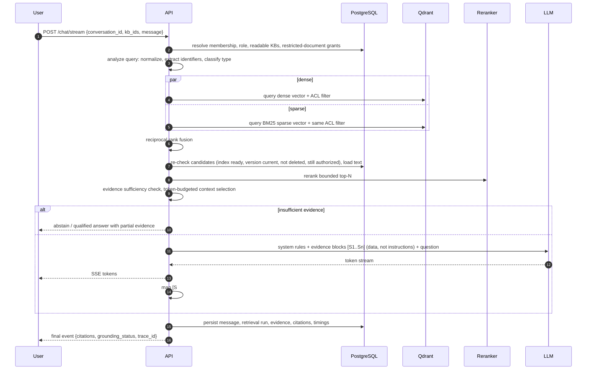
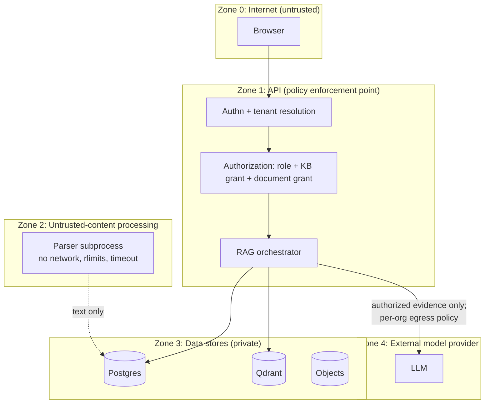

# System Architecture

Status: **design** for the full platform. The ingestion processing core and Phase 2
persistence/worker are implemented (see [README](../../README.md#implementation-status)
and the [persistence guide](ingestion-persistence.md)). Other components and the full
publication lifecycle below remain target design.

## 1. Design principles

1. **PostgreSQL is the source of truth; Qdrant is a derived index.** Any vector can be
   rebuilt from Postgres + object storage. Visibility decisions (authorization, deletion,
   active version) are made in Postgres, so they take effect at commit time.
2. **Authorization happens before retrieval**, in the vector/lexical query filter, and is
   re-checked against Postgres before any text reaches the prompt. Prompts never enforce
   security.
3. **Documents are untrusted input** at every stage: as files (parser exploits, zip bombs)
   and as text (prompt injection).
4. **Modular monolith.** One backend codebase, two process types (API, worker). No
   microservices until a measured scaling need appears.
5. **Every quality claim is measured.** Retrieval/generation changes ship with evaluation
   results; dashboards show only recorded data.

## 2. Components

| Component | Responsibility | Phase |
|---|---|---|
| `rag/` library | Pure functions: validation, parsing, normalization, chunking (done); embedding, retrieval, fusion, reranking, context selection, prompt building, citation verification | 1–5 |
| API (FastAPI) | Authentication, tenant/role resolution, REST + SSE, RAG orchestration, analytics endpoints | 5–6 |
| Worker | Claims ingestion jobs, runs the pipeline in a resource-limited subprocess, writes chunks/vectors, publishes index versions, reconciles orphans | 2–3 |
| PostgreSQL | Source of truth for tenants, ACLs, documents/versions, chunks (text + offsets), jobs, conversations, retrieval traces, evaluations, audit log | 2, 6 |
| Qdrant | Dense (cosine, 384-d) and sparse BM25 vectors in one point per chunk; payload filters for tenant/KB/document | 3–4 |
| Object storage | Original uploads and canonical text per document version (local volume in dev, S3-compatible in cloud) | 2 |
| Redis | Rate limiting and generation-cancellation signals only. **Not** the job queue (see ADR below) | 5–6 |
| LLM provider | Behind a `LLMProvider` protocol; Ollama first (no GPU required for small models, but slow on CPU) | 5 |
| Observability | OTel traces per pipeline stage; Prometheus metrics; Grafana dashboards | 10 |

### ADR-001: Job queue in PostgreSQL, not Redis

The prompt suggested Redis-backed jobs. The ingestion job row is created **in the same
transaction** as the document version row (`SELECT ... FOR UPDATE SKIP LOCKED` to claim).
With a Redis queue, a crash between the DB commit and the enqueue loses the job (or enqueues
a job for a rolled-back document): the dual-write problem. Ingestion throughput (documents
per minute, not per millisecond) is far below Postgres's queueing limits. Redis stays for
rate limiting and cancellation pub/sub, where loss is harmless.

## 3. Ingestion lifecycle

Phases 2 and 3 implement this lifecycle through the CLI and worker (the HTTP API is
Phase 6): submission, durable claiming, resource-limited subprocess parsing, chunk
persistence, embedding, Qdrant upserts and the fenced publication transaction. Embedding
reuse by `text_sha256` is not implemented yet. Details:
[vector indexing](vector-indexing.md). The subprocess has a deadline on all platforms and
CPU/address-space limits on Linux; network/syscall isolation is still deployment
hardening, not a current guarantee.

Key properties:

* **Not searchable before ready.** Points are written with `published=false`, and the
  query path re-checks `document_index.status='ready'` in Postgres.
* **Retries never duplicate.** Point IDs are `uuid5(version_id, index_fingerprint,
  chunk_index)` (implemented: `rag/ingestion/identity.py`), so a retried upsert overwrites.
  Chunk rows use `UNIQUE(document_index_id, chunk_index)` with upsert semantics.
* **Failures are recorded, never silent.** Each `IngestionError` carries a stable `code`
  and `retryable` flag (implemented: `rag/errors.py`). Bad input fails fast; transient
  infrastructure errors retry with backoff up to `max_attempts`.
* **Worker crash recovery.** Jobs whose `heartbeat_at` is stale are reclaimed; because all
  writes are idempotent, resuming from the start is safe.

## 4. Query lifecycle

> **Status (Phase 5):** implemented through the CLI (`kip ask`), without the HTTP API,
> streaming, or user authorization (Phase 6). Authorization is organization/KB scope only.
> The citation support check is lexical rather than NLI, and publication authority (current,
> superseded, withdrawn) shapes evidence selection. See
> [grounded answers](grounded-answers.md).

## 5. Security boundaries

| Threat | Control |
|---|---|
| Cross-tenant retrieval | `org_id` in every Qdrant filter and SQL predicate; composite FKs `(kb_id, org_id)`; dedicated cross-tenant tests in `tests/security/` |
| Revoked access / deleted document still retrievable | Visibility decided in Postgres at query time; Qdrant cleanup is asynchronous but never authoritative |
| Malicious files | Magic-byte validation, size/page/char limits, zip-bomb & macro rejection (implemented); sandboxed parser subprocess (Phase 2) |
| Prompt injection in documents | Evidence wrapped as quoted data, never as instructions; no tool use during answer generation; output citation labels validated server-side. Limitation: prompt-level defences reduce but do not eliminate injection; they never guard data access |
| Data leakage via logs | Question and document text excluded from logs by default; traces store IDs, counts, timings |
| Data egress to hosted LLMs | Per-organization provider policy; local Ollama is the default |

## 6. Consistency policy (Postgres / object storage / Qdrant)

| Operation | Visible effect | Cleanup |
|---|---|---|
| Upload | Searchable only when `document_index.status='ready'` commits | n/a |
| New version | Old version invisible at commit of new `current_version_id` | Old points deleted by worker; reconciler retries |
| Delete document | Invisible at commit of `deleted_at` | Points deleted by filter; object deleted; rows hard-deleted after retention window |
| Revoke KB/document access | Effective on the next query (filter computed per request) | `restricted` payload refreshed asynchronously |
| Partial failure | Never visible (gate is the Postgres status) | Reconciler: points whose `document_index` is not `building`/`ready` are deleted; `building` older than TTL is failed and retried |

The query path counts candidates dropped by the Postgres re-check. A non-zero rate is
the `index_consistency_drift` metric that surfaces reconciler lag.
