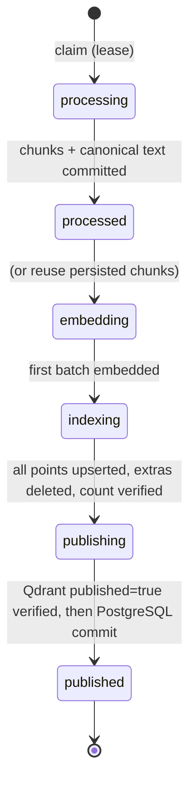

# Embeddings, vector indexing and dense retrieval (Phase 3)

> **Phase 4 update:** BM25, hybrid search, reranking, vector cleanup, candidate
> replenishment and failed-job retry are described in
> [hybrid retrieval](hybrid-retrieval.md). Items marked *(Phase 4)* below are addressed there.

Phase 3 extends the Phase 2 worker from "chunks persisted" to "searchable", and adds a
scoped dense-search CLI. PostgreSQL remains the authority for what is visible; Qdrant only
proposes candidates. Authentication, the HTTP API, BM25/hybrid search, reranking and
answer generation are later phases.

## Commands

Prerequisites: the Phase 2 setup ([ingestion persistence](ingestion-persistence.md)) plus
CPU-only PyTorch, installed **before** the project so pip does not pull CUDA wheels:

```powershell
python -m pip install torch --index-url https://download.pytorch.org/whl/cpu
python -m pip install -e ".[dev]"
docker compose up -d postgres qdrant
alembic upgrade head
```

```powershell
$setup = kip bootstrap --revision 1110a243fdf4706b3f48f1d95db1a4f5529b4d41 | ConvertFrom-Json
kip submit "path/to/guide.pdf" --org $setup.org_id --kb $setup.kb_id --index $setup.index_version_id
kip-worker --until-idle          # parse -> embed -> index -> publish every due job, then exit
kip activate-index $setup.index_version_id
kip search "how long are incident records retained?" --org $setup.org_id --kb $setup.kb_id --top-k 5
```

| Command | Purpose |
|---|---|
| `kip-worker [--once \| --until-idle]` | Process jobs through publication. Without a flag it polls forever. |
| `kip search QUERY --org ID --kb ID [--kb ID ...] [--index ID] [--top-k N] [--max-chars N]` | Dense search. Organization and at least one KB are mandatory; an unknown, deleted or foreign KB is refused (never silently dropped). Defaults to the active index version. |
| `kip activate-index ID` | Make an index version the default for search. The previously active one returns to `building` (still usable with `--index`). |
| `kip requeue-processed --org ID` | Continue jobs that Phase 2 finished at `stage=processed`. Persisted chunks are reused, not reparsed. Only completed jobs whose document index is still `building` are touched; running it twice is a no-op. |

The first worker or search run downloads the pinned model (about 90 MB) into the Hugging
Face cache. Set `HF_HUB_OFFLINE=1` afterwards to avoid network calls. In Compose, the
worker gets `KIP_QDRANT_URL=http://qdrant:6333` and caches models under `./data`.

Settings (environment or `.env`, prefix `KIP_`): `QDRANT_URL`, `QDRANT_API_KEY`,
`QDRANT_TIMEOUT_SECONDS`, `EMBED_BATCH_SIZE` (1–256, default 32), `EMBED_DEVICE`
(default `cpu`), `SEARCH_OVERFETCH` (default 4).

## Embedding model

`SentenceTransformerEmbedder` (in `rag/embeddings/`) loads
`sentence-transformers/all-MiniLM-L6-v2` at an **immutable commit**. A branch name such as
`main` is rejected, because it could change the model under an existing index. On load it
verifies, rather than assumes, the values recorded in `embedding_models`:

| Property | Verified value | Failure |
|---|---|---|
| Embedding dimension | 384 | `embedding_model_mismatch` (job fails, nothing written) |
| `max_seq_length` | 256 (254 content tokens) | `embedding_model_mismatch` |
| Output normalization | final `Normalize` module; every vector checked for unit norm (±1e-3), finiteness and size | `embedding_invalid_vector` |
| Inputs | any text over 254 tokens is refused, never truncated | `embedding_token_limit` |

A real-model test confirms that the chunker's tokenizer and the embedder's tokenizer give
identical token counts on generated chunks, so the chunk budget is enforced in the same
units the model uses. Queries longer than the window are refused with a clear error.

## Qdrant layout

One collection per index version (`index_versions.qdrant_collection`), one point per chunk:

* named vector `dense`: 384-d, cosine;
* payload: `org_id` (keyword index, `is_tenant=true`), `kb_id`, `document_id`,
  `document_version_id`, `document_index_id` (keyword), `chunk_index` (integer),
  `published` (bool). **No chunk text.**
* point id = `document_chunks.id` = UUIDv5(version, index fingerprint, chunk index).

An existing collection with a different vector name, size or distance fails the job with
`vector_collection_mismatch` instead of being written to. The client is pinned to the
server's minor version (`qdrant-client 1.18.x` with server `1.18.3`).

## Job stages and publication



All stages run inside the same leased attempt; heartbeats continue during model loading
and every embedding batch. The PostgreSQL publication transaction is fenced by the lease
token and:

1. re-locks the document and fails with `document_deleted` if it or its KB was deleted
   (the attempt then deletes its own points);
2. checks that the persisted chunk count still equals the number of vectors written;
3. marks the document index `ready` with `published_at`;
4. advances `documents.current_version_id` **only** if this version is newer than the
   current one. The previous version becomes `superseded` and its points are unpublished.
   An older version that finishes late is indexed but never becomes current.

## Failure and recovery

| Situation | Result | Visibility |
|---|---|---|
| Qdrant unreachable (any step) | `vector_store_unavailable`, retried with backoff (3 attempts) | invisible: index stays `building` |
| Model download/load fails (network, disk) | `infrastructure_error`, retried | invisible |
| Unpinned revision or other config error | `configuration_error`, not retried | invisible |
| Model or collection mismatch, over-long chunk | stable non-retryable code | invisible; nothing written for mismatches |
| Crash after upsert, before Qdrant publish | lease expires; next attempt reuses chunks and overwrites the same point ids | invisible (`published=false`, index `building`) |
| Crash after Qdrant publish, before PostgreSQL commit | next attempt completes publication | **still invisible**: search re-check requires index `ready` (tested) |
| Earlier attempt wrote more points | removed by `chunk_index >= n` delete before counting | n/a |
| Document deleted during indexing | `document_deleted`; this attempt's points deleted | invisible |
| Document deleted after publication | search excludes it immediately (PostgreSQL re-check); points remain in Qdrant | invisible |

## Dense search and the re-check

`kip.retrieval.dense_search`:

1. resolves the index version (explicit, or the single `active` one);
2. verifies every requested KB belongs to the organization and is not deleted;
3. checks that the embedder matches the index's model, revision, dimension and window;
4. embeds the query and searches Qdrant with filters `org_id`, `kb_id IN (...)` and
   `published=true`, over-fetching `top_k × SEARCH_OVERFETCH` candidates;
5. **re-checks every candidate in PostgreSQL**: same organization; chunk's document
   index `ready` in this index version; the version is the document's `current_version_id`
   with status `ready`; document and KB not deleted; KB in the requested scope.
6. returns chunk text, exact character offsets, page range, heading path, version number,
   score and both ranks. `dropped_by_recheck` reports candidates Qdrant returned that
   PostgreSQL rejected, a signal of stale or inconsistent vector state.

Tests include a forged Qdrant payload: another tenant's chunk relabelled with this tenant's
`org_id`/`kb_id`. It reaches the candidate list and is removed by the re-check.

Scores are cosine similarities for one query. They are not probabilities, not calibrated,
and not comparable across queries or models.

## Container verification

The Linux worker image (CPU-only PyTorch, about 2.1 GB, of which torch is about 770 MB)
processed and published a Markdown document. That document was then found with
`kip search` run inside the container: the expected chunk ranked first, with its heading
path and the front-matter title. PostgreSQL ready chunks and Qdrant points matched
exactly (1,307 each).

This test found a real defect. The parser child of the multiprocessing `spawn` start
method re-imports the worker's module graph, which had begun importing `qdrant_client`
(numpy plus grpc). On a 24-CPU host its thread pools reserved 1.17 GB of virtual memory,
exceeding the 1 GB `RLIMIT_AS` before any parsing, so every document failed with
`parser_memory_limit`. Fixes: `rag/indexing/base.py` holds the import-free contract and
`qdrant_client` is imported lazily, giving a 98 MB footprint;
`tests/unit/test_import_weight.py` guards the import graph; and the limit is now applied
as headroom over the child's startup footprint.

## Evaluation

The first reproducible retrieval evaluation is described in
[evals/datasets/nist-security/README.md](../../evals/datasets/nist-security/README.md).

## Limitations

* **No access control beyond tenant/KB scope.** The CLI trusts its operator; users,
  roles and document-level grants arrive with the API.
* *(Phase 4)* **Deleting published documents leaves vectors.** `kip cleanup-vectors`
  now removes them with retryable two-phase cleanup, and search replenishes candidates
  dropped by the re-check (bounded by `SEARCH_MAX_CANDIDATES`).
* **Partial reconciler:** cleanup covers deleted documents and superseded versions, but
  not unpublished points of a newer version whose job failed permanently.
* **Embedding reuse across versions is not implemented.** Unchanged chunks are re-embedded
  (about 57 chunks/s for 190-token chunks on the development CPU).
* **Model loads take a lease-heartbeat thread**, but a stuck download cannot be killed;
  the lease is still fenced, so a stale attempt cannot commit.
* *(Phase 4)* **Dense-only retrieval is weak on identifiers and some paraphrases.**
  BM25, hybrid and reranking were added and compared; see the hybrid retrieval guide.
* **Multiple index versions:** a newer version becomes current when it is ready in *any*
  index. It is absent from other index versions until they process it; older content is
  never shown in its place.
* **Table-of-contents chunks** (dot leaders and page numbers) are indexed and sometimes
  retrieved. Phase 4 measures how often in every mode; no TOC filtering exists yet.
